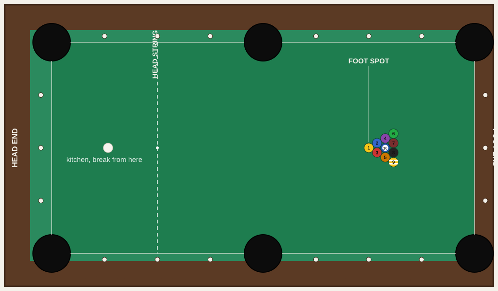

## Basic Information

10-Ball is a pocket billiards (pool) discipline played on a standard 9-foot table with ten object balls numbered 1 through 10 plus the cue ball. At the professional level it is governed by the World Pool-Billiard Association (WPA), which sanctions an official World Ten-ball Championship, and it is a fixture of major professional tours and world championship events. Its stricter call-shot character makes it the professional sibling of 9-ball: see also [8-Ball Pool](8-ball-pool.html), [9-Ball Pool](9-ball-pool.html) and [Billiards](billiards.html) on this site.

Among the best-known players of the modern era are Shane Van Boening, Dennis Orcullo and Carlo Biado; the 2026 WPA men's world ten-ball champion is Wojciech Szewczyk of Poland (WPA, n.d.-b). On the women's side, the Philippines' Chezka Centeno has taken the Women's World Ten-ball Championship title twice in recent years (2023 and 2025), and Austria's Jasmin Ouschan heads the WPA women's world ranking (WPA, n.d.-a; WPA, n.d.-b).

*Figure: RailbirdJAM. (2007, June 12). Pool player Shane Van Boening [Photograph]. Wikimedia Commons. Public domain. https://commons.wikimedia.org/wiki/File:Shane_Van_Boening.JPG*

*Figure: Jung, Y. H. (U.S. Army). (2013, December 20). Ga-Young Kim, women's world ten-ball champion 2012, playing an exhibition game [Photograph]. Wikimedia Commons. Public domain. https://commons.wikimedia.org/wiki/File:Kim_Ga-young_2013-1.jpg*

## Rules

Under the WPA Rules of Play, 10-ball is a call-shot game: the balls are played in ascending numerical order and the cue ball must contact the lowest-numbered ball first (World Pool-Billiard Association [WPA], 2025). Every shot except the break and a push-out must be called (ball and pocket). The break is from ball-in-hand behind the head string, and if nothing is pocketed at least four object balls must reach a rail. The balls are racked in a triangle with the 1-ball on the foot spot and the 10-ball in the middle of the third row; the remaining balls are placed randomly.

If the 10-ball is pocketed on the break, on a push-out, on a foul, or before it is the last ball remaining, it is spotted (placed back on the foot spot or as close as possible on the long string) and play continues; the rack is won by legally pocketing the called 10-ball last. A standard foul gives the opponent ball-in-hand anywhere on the table, and three consecutive fouls lose the rack. The table itself follows standard pool equipment specifications: a 9-foot table with a playing surface of about 254 cm x 127 cm (100 x 50 inches), six pockets and 57.15 mm (2 1/4 inch) balls, with diamond sights dividing the rails into eighths and quarters (WPA, 2025).

*Figure: SMcCandlish. (2008, February 18). One of many valid ten-ball racks, with the 1-ball at the apex on the foot spot and the 10-ball in the centre [Photograph]. Wikimedia Commons. CC BY-SA 4.0. https://commons.wikimedia.org/wiki/File:Ten-ball_rack.jpg*

*Figure: Own diagram, drawn to scale (9 px per inch) with six equal-sized pockets at the four corners and the midpoints of the long rails, based on the WPA Rules of Play and standard 9-foot table equipment specifications (World Pool-Billiard Association, 2025), with pocket geometry and break setup cross-checked against Dr. Dave Billiards' 10-ball break reference at https://drdavepoolinfo.com/faq/break/10-ball/*

The diagrams above show the table geometry — six equal pockets set into the rails, diamond sights dividing the cushions — and the rack layout with the 1-ball on the foot spot and the 10-ball in the middle of the third row. There are no gender-specific rule differences in 10-ball as there are, for example, in volleyball's net heights: men, women and wheelchair athletes play the identical rule set. Instead, the sport separates athletes by division — the WPA and its continental members run men's, women's, junior/youth and wheelchair divisions of their world and continental championships (WPA, n.d.-c). Note also that rule sets differ outside the WPA: some US league formats (for example CSI/BCAPL) treat a legally pocketed called 10-ball as an immediate win at any point of the rack (Cue Sports International, n.d.) — a good example of how the same game exists with different official variants.

## History

10-ball grew out of 9-ball in the United States in the mid-20th century as a way to reduce the influence of luck: because every ball except the break must be called, "fluke" successes on a lucky roll do not decide racks the way they can in 9-ball. The game became a staple of professional pool in the 1990s and 2000s, when dedicated 10-ball tournaments attracted some of the largest fields in the sport, and the WPA added 10-ball to its list of sanctioned world championships (WPA, n.d.-c).

The World Pool-Billiard Association itself was founded in 1987 as the international governing body for pool, with continental confederations — such as the European Pocket Billiard Federation (EPBF), which has run the European Championships since 1980, and the Asian Confederation of Billiard Sports (ACBS) for Asia — grouping the national federations (European Pocket Billiard Federation [EPBF], n.d.; WPA, n.d.-c). Today 10-ball features on the biggest professional stages, including major world championship and invitation events promoted by Matchroom Pool (Matchroom Pool, n.d.). The WPA sanctions a Women's World Ten-ball Championship alongside the men's event: Rubilen Amit of the Philippines won the inaugural title in 2009 and became the first two-time women's world ten-ball champion in 2013, South Korea's Ga-Young Kim won in 2012, and the Philippines' Chezka Centeno has taken the title twice in recent years (2023 and 2025) (WPA, n.d.-b).

## Sources

- Cue Sports International. (n.d.). *Official rules of play*. Retrieved November 21, 2026, from https://www.playcsipool.com/
- European Pocket Billiard Federation. (n.d.). *The governing body of European pool*. Retrieved November 21, 2026, from https://www.epbf.com/
- Matchroom Pool. (n.d.). *Matchroom Pool*. Retrieved November 21, 2026, from https://matchroompool.com/
- World Pool-Billiard Association. (n.d.-a). *Rankings*. Retrieved November 21, 2026, from https://wpapool.com/rankings/
- World Pool-Billiard Association. (n.d.-b). *World champions*. Retrieved November 21, 2026, from https://wpapool.com/world-champions/
- World Pool-Billiard Association. (n.d.-c). *World Pool-Billiard Association*. Retrieved November 21, 2026, from https://wpapool.com/
- World Pool-Billiard Association. (2025). *Rules of play* (effective September 15, 2025). https://wpapool.com/wp-content/uploads/2025/09/2025.09.15-WPA-Rules.pdf

### Figure Index

- Jung, Y. H. (U.S. Army). (2013, December 20). *Ga-Young Kim, women's world ten-ball champion 2012, playing an exhibition game* [Photograph]. Wikimedia Commons. Retrieved November 21, 2026, from https://commons.wikimedia.org/wiki/File:Kim_Ga-young_2013-1.jpg (Public domain)
- RailbirdJAM. (2007, June 12). *Pool player Shane Van Boening* [Photograph]. Wikimedia Commons. Retrieved November 21, 2026, from https://commons.wikimedia.org/wiki/File:Shane_Van_Boening.JPG (Public domain)
- SMcCandlish. (2008, February 18). *Ten-ball rack, one of many valid racks* [Photograph]. Wikimedia Commons. Retrieved November 21, 2026, from https://commons.wikimedia.org/wiki/File:Ten-ball_rack.jpg (CC BY-SA 4.0)

## Important Links

- [World Pool-Billiard Association (WPA)](https://wpapool.com/) — world governing body; sanctions the world championships and publishes the Rules of Play
- [WPA Rules of Play (official PDF)](https://wpapool.com/wp-content/uploads/2025/09/2025.09.15-WPA-Rules.pdf) — official current rules including 10-ball
- [WPA Rankings](https://wpapool.com/rankings/) — official world rankings (men and women)
- [WPA World Champions](https://wpapool.com/world-champions/) — list of all WPA world champions by division, including 10-ball
- [European Pocket Billiard Federation (EPBF)](https://www.epbf.com/) — European continental federation; European Championships and Euro Tour
- [World Confederation of Billiards Sports (WCBS)](https://www.billiard-wcbs.org/) — international umbrella confederation of the cue sports
- [Matchroom Pool](https://matchroompool.com/) — major professional pool events and world championship promotion
- [Cue Sports International (CSI/BCAPL)](https://www.playcsipool.com/) — major US league with its own 10-ball variant rules
