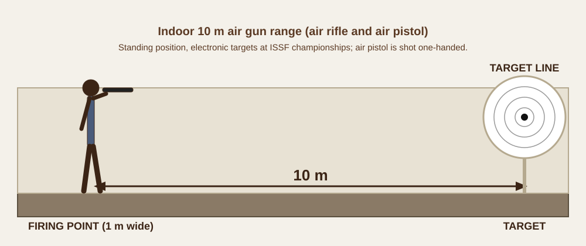

## Basic Information

10m Air Pistol is a precision shooting discipline governed by the International Shooting Sport Federation (ISSF). Shooters fire one-handed at a target 10 meters away on an indoor range. It has been an Olympic event since Seoul 1988 and is also contested at the ISSF World Championships, World Cups and continental championships, alongside a mixed-team event that debuted at the Tokyo 2020 Games. See also [10m Air Rifle Shooting](10m-air-rifle-shooting.html) and [Shooting](shooting.html) on this site.

## Rules

Under ISSF rules the pistol is a single-shot compressed-air or gas pistol in 4.5 mm (.177) caliber with a minimum trigger weight of 500 g and a maximum muzzle energy of 7.5 joules (International Shooting Sport Federation [ISSF], 2023). The grip may not touch the wrist or rest on the shooting hand beyond defined limits, and no support of any kind is allowed — firing is strictly one-handed from the standing position. The 10m air pistol target carries a 10-ring of only 11.5 mm diameter; qualification is scored in whole rings from 1 to 10 with the inner ten counting 10.9, while finals are scored in decimals.

The current qualification program is 60 competition shots within 75 minutes, and the top eight athletes advance to a final of 24 additional shots with progressive eliminations after set stages (ISSF, 2023). An important equality milestone: women's qualification was expanded from 40 to the identical 60-shot program in the 2018 rules revision, so men and women now shoot the same course of fire in the individual events (ISSF, 2023). The ISSF also runs team, mixed-team and junior events; the mixed-team event, with one man and one woman per team shooting a duel-format match, celebrated its Olympic debut at Tokyo 2020.

The equipment and course of fire are identical for all genders and for juniors — differences exist only between the men's, women's, mixed-team and junior event labels, not in the rules themselves. By contrast, classification-based para shooting has its own separate formats and classifications under the same world federation.

## History

10m air pistol joined the World Championship program in 1970 and became an Olympic event at Seoul 1988; the ISSF itself was founded in 1907 as the international umbrella for sport shooting (ISSF, n.d.; International Olympic Committee [IOC], n.d.). Before the equalization of the qualification, the men's match went from 40 to 60 shots in 1982, and the target was reduced in size in 1989, resetting the records of the era.

Among the most successful athletes are Jin Jong-oh of South Korea, whose three Olympic golds include the 10m air pistol title at London 2012, Olena Kostevych of Ukraine (gold at Athens 2004) and Zorana Arunović of Serbia. At Tokyo 2020 the inaugural mixed-team Olympic title was won by China's Jiang Ranxin and Pang Wei, whose world-class results include an Olympic qualification record of 587 points (IOC, n.d.).

## Sources

- International Olympic Committee. (n.d.). *Shooting*. Olympics.com. Retrieved November 21, 2026, from https://olympics.com/en/sports/shooting/
- International Shooting Sport Federation. (n.d.). *International Shooting Sport Federation*. Retrieved November 21, 2026, from https://www.issf-sports.org/
- International Shooting Sport Federation. (2023). *ISSF rules: General technical and pistol rules (Edition 2022, first print January 2023)*. Retrieved November 21, 2026, from https://www.issf-sports.org/rules
- USA Shooting. (n.d.). *USA Shooting — national governing body*. Retrieved November 21, 2026, from https://www.usashooting.org/

## Important Links

- [ISSF — International Shooting Sport Federation](https://www.issf-sports.org/) — world governing body; World Championships and World Cups
- [ISSF official rules](https://www.issf-sports.org/rules) — current rulebook (general technical and pistol rules)
- [ISSF World Championships](https://www.issf-sports.org/championships) — official world championship pages
- [European Shooting Confederation (ESC)](https://www.esc-shooting.org/) — continental federation for Europe; European Championships
- [Olympics.com — Shooting](https://olympics.com/en/sports/shooting/) — Olympic history and results (10m air pistol since Seoul 1988)
- [USA Shooting](https://www.usashooting.org/) — national federation (example)
