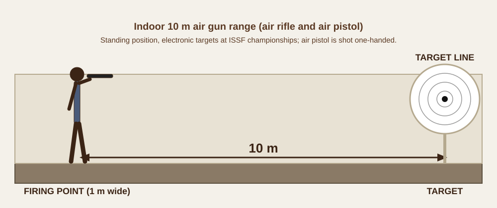

## Basic Information

10m Air Rifle is the flagship precision event of the ISSF shooting program: athletes shoot standing at a target 10 meters away on an indoor range. It has been on the Olympic program since Los Angeles 1984 and anchors the ISSF World Championships, World Cups, continental championships and Youth Olympic Games, with team, mixed-team and junior events completing the program. See also [10m Air Pistol Shooting](10m-air-pistol-shooting.html), [50m Rifle 3 Positions Shooting](50m-rifle-3-positions-shooting.html) and [Shooting](shooting.html) on this site.

## Rules

Under ISSF rules the rifle is a compressed-air or gas rifle in 4.5 mm (.177) caliber with a maximum muzzle energy of 7.5 joules and a maximum weight of 5.5 kg, fired from the standing position at a 10 m target whose 10-ring is only 0.5 mm in diameter — the smallest and most demanding ring in all of sport shooting (International Shooting Sport Federation [ISSF], 2023). The current qualification is 60 competition shots within 75 minutes, scored in whole rings from 1 to 10 with the inner ten counting 10.9; finals are shot on the same target but scored in decimal tenths. The top eight shooters advance to a final of 24 additional shots with progressive eliminations after set stages (ISSF, 2023).

As in 10m air pistol, the 2018 rules revision ended the historical gender difference: the women's qualification was expanded from 40 to the identical 60-shot program, so men and women now shoot the same course of fire (ISSF, 2023). Juniors shoot the same 60-shot program in their own junior events, with dedicated team competitions as well. Clothing and rifle supports are strictly limited in the standing position — no slings are allowed, and thick, stiff shooting clothing is restricted in this event so that the full stability demand remains on the athlete.

*Figure: Own diagram of a standard 10 m indoor air gun range, based on the ISSF General Technical Rules (International Shooting Sport Federation, 2023). No third-party images are used on this page.*

Variants: beyond individual finals, the ISSF runs three-athlete team events decided on aggregated qualification scores and mixed-team duels; many national federations additionally run club and postal matches with different shot counts.

## History

10m air rifle entered the Olympic program at Los Angeles 1984, replacing earlier smallbore standing events in the Olympic schedule, and has since become the most universal entry point into Olympic shooting: its low equipment barrier compared with range-based smallbore events made it a first international event for shooters from Asia, Europe and the Americas alike (International Olympic Committee [IOC], n.d.).

Abhinav Bindra of India won India's first individual Olympic gold medal in this event at Beijing 2008 — a milestone with enormous significance for Indian sport. Other defining champions include Niccolò Campriani of Italy (gold at Rio 2016, silver at London 2012) and the multiple Chinese world and Olympic champions Zhu Qinan and Du Li, whose 2004 Athens title in this event began a dynasty of Chinese air-rifle excellence (IOC, n.d.).

## Sources

- International Olympic Committee. (n.d.). *Shooting*. Olympics.com. Retrieved November 21, 2026, from https://olympics.com/en/sports/shooting/
- International Shooting Sport Federation. (n.d.). *International Shooting Sport Federation*. Retrieved November 21, 2026, from https://www.issf-sports.org/
- International Shooting Sport Federation. (2023). *ISSF rules: General technical and rifle rules (Edition 2022, first print January 2023)*. Retrieved November 21, 2026, from https://www.issf-sports.org/rules
- USA Shooting. (n.d.). *USA Shooting — national governing body*. Retrieved November 21, 2026, from https://www.usashooting.org/

## Important Links

- [ISSF — International Shooting Sport Federation](https://www.issf-sports.org/) — world governing body; World Championships and World Cups
- [ISSF official rules](https://www.issf-sports.org/rules) — current rulebook (general technical and rifle rules)
- [ISSF World Championships](https://www.issf-sports.org/championships) — official world championship pages
- [European Shooting Confederation (ESC)](https://www.esc-shooting.org/) — continental federation for Europe; European Championships
- [Olympics.com — Shooting](https://olympics.com/en/sports/shooting/) — Olympic history and results (10m air rifle since Los Angeles 1984)
- [USA Shooting](https://www.usashooting.org/) — national federation (example)
