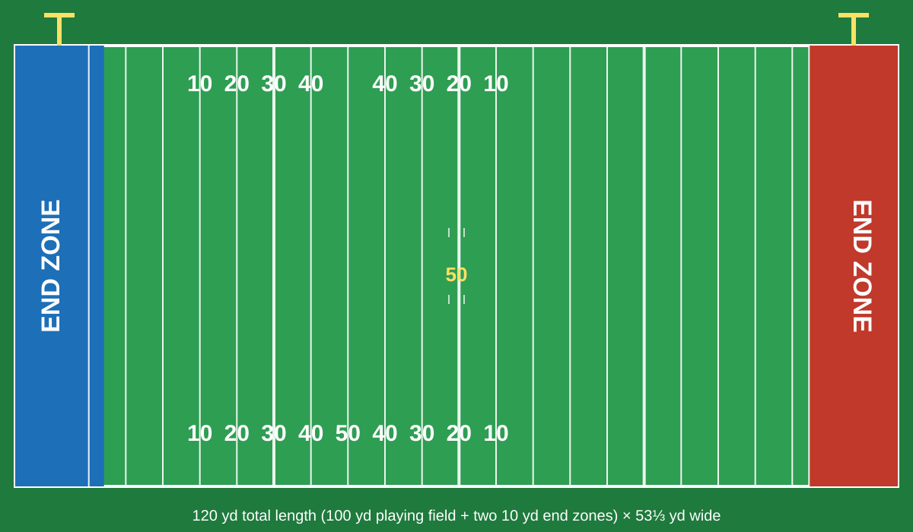

## Basic Information

American Football is a contact team sport played with an oval ball: 11 players per side try to advance the ball into the opponent's end zone by running or passing. The NFL (National Football League) is the top professional league in the US; internationally the sport is governed by the International Federation of American Football (IFAF), and flag football will be an Olympic sport at Los Angeles 2028.

## Rules

A game consists of four 15-minute quarters. The offense has four "downs" to advance the ball at least 10 yards; failing that, possession turns over. Points are scored by a touchdown (6), field goal (3), safety (2) and extra points after touchdowns. The defense can score via interceptions, fumbles and safeties. Full NFL rules cover penalties, timing and the two-minute warning. Variants: college football (NCAA) has some different rules (e.g. hash marks, clock stops), and flag football — non-contact, played with belts/tags — is the Olympic variant.

## History

American football evolved from rugby and soccer in the United States in the late 19th century; Walter Camp's rule changes in the 1880s (downs, line of scrimmage) shaped the modern game. The NFL was founded in 1920 (as the APFA), and the Super Bowl, first played in 1967, is one of the world's biggest annual sporting events.

## Sources

- International Federation of American Football. (n.d.). *IFAF — international federation*. Retrieved November 20, 2026, from https://ifaf.org/
- National Football League. (n.d.). *NFL — official site and rules*. Retrieved November 20, 2026, from https://www.nfl.com/

## Important Links

- [IFAF — International Federation of American Football](https://ifaf.org/) — world governing body; flag football at LA 2028
- [NFL — National Football League](https://www.nfl.com/) — top professional league, official rules and the Super Bowl
